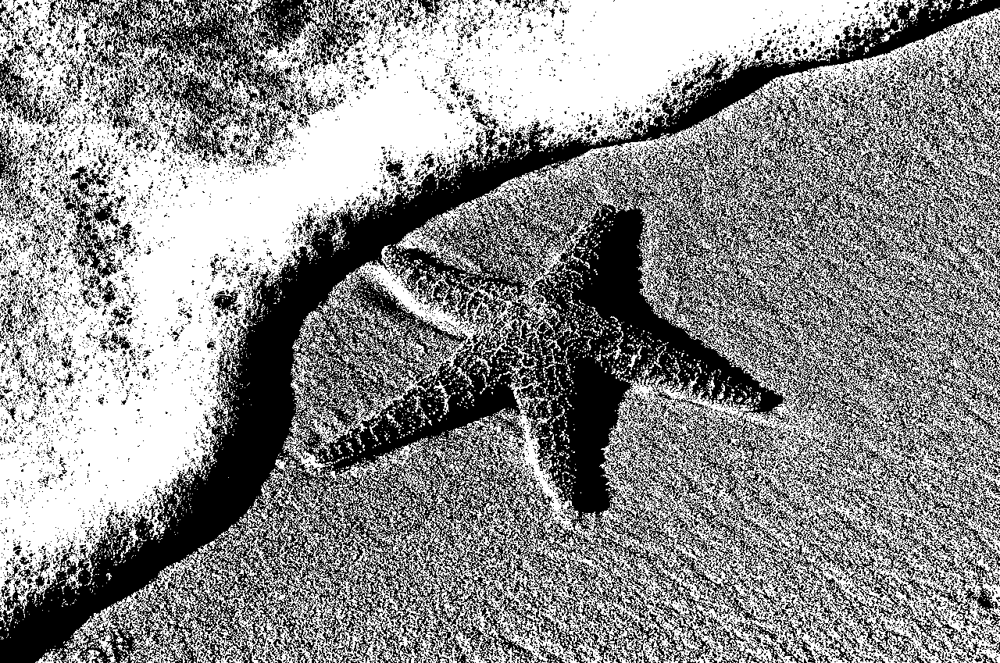
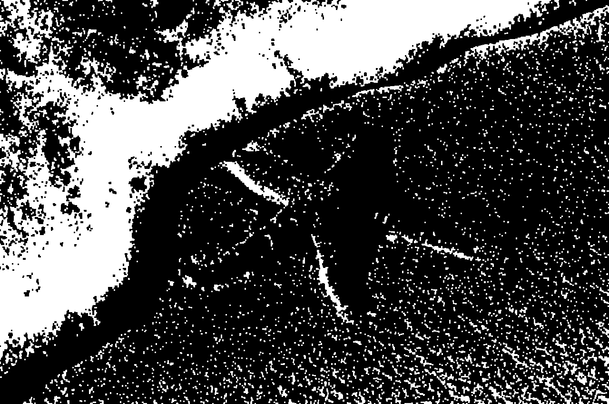
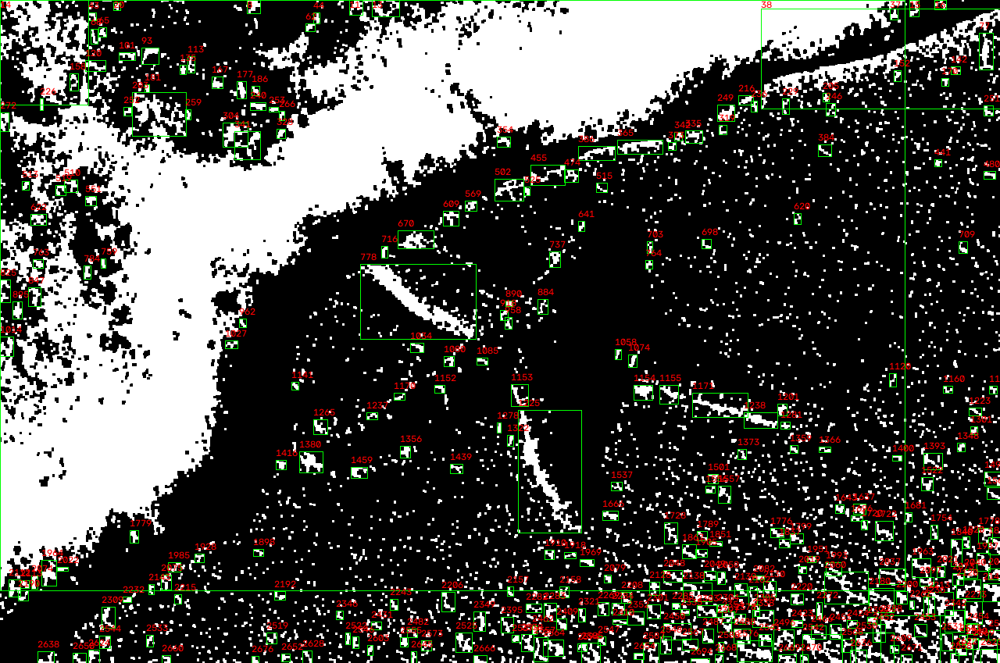

## Laboratório M2.2 — Componentes Conexos e Sequência Morfológica

### 1. Sequência Morfológica e Justificativa das Escolhas
Para refinar a máscara binária inicial da imagem `imagem_teste.jpg`, foi aplicada uma sequência morfológica composta por **Abertura** seguida de **Fechamento**, utilizando um elemento estruturante retangular de 3x3 pixels (1 iteração cada).

* **Abertura:** Escolhida para eliminar pequenos ruídos isolados no fundo de areia e desconectar eventuais artefatos.
* **Fechamento:** Aplicado em seguida para preencher pequenos buracos escuros dentro da estrela-do-mar, garantindo que o seu corpo principal seja reconhecido como um componente conexo sólido.

### 2. Comparativo de Componentes (Antes e Depois)

| Imagem / Máscara | Área Total Primeiro Plano | Componentes Brutos | Componentes Após Filtro | Observações Principais |
| :--- | :--- | :--- | :--- | :--- |
| `imagem_teste.jpg` | 600.021 -> 314.678 pixels | 2727 | 299 | A abertura reduziu a área do primeiro plano quase pela metade (limpando ruídos de fundo), mas objetos fragmentados ainda precisaram do filtro de área (>= 50). |

### 3. Visualização dos Estágios

| Máscara Inicial | Após Abertura (Estágio 1) | Após Fechamento (Estágio 2) | Resultado Final com Caixas |
| :---: | :---: | :---: | :---: |
|  |  |  |  |

### 4. Análise Teórica
**Conectividade 4 vs. 8:** 
Como visto no terminal, a conectividade 4 detetou 22.359 componentes, enquanto a 8 detetou 5.785. A conectividade 4 considera apenas vizinhos na horizontal e vertical, fragmentando formas diagonais (muito comuns na textura da areia) em múltiplos rótulos. A conectividade 8 inclui as diagonais, unindo melhor as formas naturais e reduzindo o número bruto de componentes.

**Efeitos Indesejados e Limitações:**
Embora o fechamento ajude a tapar buracos na estrela, se houvesse duas estrelas muito próximas, a dilatação do fechamento poderia fundi-las num único objeto, subestimando a contagem real.

**Interpretação Humana vs. Máquina:**
A contagem da máquina não equivale necessariamente à interpretação humana, pois baseia-se estritamente na adjacência de pixels. Para um humano, uma estrela-do-mar levemente coberta por areia ao meio é visualmente "1 objeto". No entanto, se essa quebra separar os pixels brancos da máscara, o algoritmo de componentes conexos contará matematicamente como "2 objetos". Portanto, ruídos e oclusões fazem com que a quantidade de componentes detectados divirja do número real de objetos na cena.